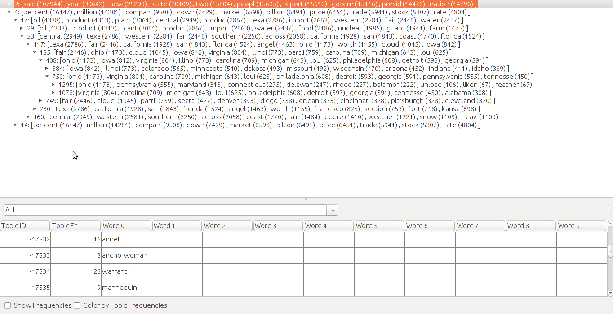

# Topic Grouper

Topic Grouper (TG) is a probabilistic topic model that is computed by agglomerative clustering of
the vocabulary. This document explains the model and the algorithm, presents the evaluation of the papers
with its figures, and derives the extension for homonyms (`SenseSplittingTopicGrouper`). Sections 1 to 5 are
based on the paper and the slides of the ECIR 2019 talk:

* D. Pfeifer, J. L. Leidner: *Topic Grouper: An Agglomerative Clustering Approach to Topic Modeling.* ECIR 2019.
  [Springer](https://link.springer.com/chapter/10.1007/978-3-030-15712-8_38), extended version
  [arXiv:1904.06483](http://arxiv.org/abs/1904.06483).
* The conference slides: [`TopicGrouperECIR2019.pdf`](../TopicGrouperECIR2019.pdf).

The companion document [`feature-reduction.md`](feature-reduction.md) covers the paper *Feature reduction using
topic modeling*, which uses Topic Grouper's topics as features for text classification.

All figures are drawn by the module [`eval`](../eval/README.md) into `results/figs/` and referenced here from
`figs/`; Appendix A lists them. Formulas are written in LaTeX (rendered by GitHub). Notation follows the slides:

| Symbol | Meaning |
|---|---|
| $D$, $V$ | training documents, vocabulary |
| $f_d(w)$ | frequency of word $w$ in document $d$ |
| $f(w) = \sum_{d} f_d(w)$ | frequency of $w$ in $D$ |
| $\lvert d\rvert = \sum_{w} f_d(w)$ | size of document $d$ |
| $T$, $t \subseteq V$ | set of topics, a topic (a set of words) |
| $f_d(t) = \sum_{w\in t} f_d(w)$, $f(t) = \sum_d f_d(t)$ | frequencies of a topic |
| $\xi(x) = x \ln x$ | auxiliary function ($\xi(0) = 0$), not on the slides |

## 1. Topic modeling in general

A topic model is an unsupervised procedure on a document collection $D$. A topic $t$ is a distribution
$p(w\mid t)$ over the vocabulary; words with high probability co-occur in $D$ and form the "essence" of
$t$. A document is a mixture of topics, described by $p(t\mid d)$. Basic approaches need the number of topics
$\lvert T\rvert$ as a hyper parameter.

Under maximum likelihood the documents are bags of words with frequencies $f_d(w)$:

$$
\arg\max_\Phi p(D\mid\Phi) = \arg\max_\Phi \prod_{d\in D} p(d\mid\Phi),
\qquad
p(d\mid\Phi) = \prod_{w\in V} p(w\mid d)^{f_d(w)} .
$$

For topic models $p(w\mid d)$ is a compound: first a topic $t$ is generated via $d$, then $w$ via $t$:

$$
p(w\mid d) := \sum_{t\in T} p(w\mid t)\, p(t\mid d) .
$$

This is the oldest probabilistic topic model, pLSI. LDA adds priors on $p(w\mid t)$ and $p(t\mid d)$ and
averages over them. The price is a set of hyper parameters (number of topics, Dirichlet parameters
$\alpha$, $\beta$) to which results are quite sensitive; stop words pollute topics; hierarchical variants
are either simple and unsatisfactory or need even more hyper parameters.

## 2. The model of Topic Grouper

Topic Grouper makes a deliberate (and debatable) simplification: **every word is in exactly one topic.** There is a
function $t(w): V \to T$, a topic is a set of words, and $T$ is a partitioning of $V$:

$$
s \cap t = \emptyset \ \text{ for } s \ne t \in T,
\qquad
\bigcup_{t\in T} t = V .
$$

The maximum likelihood estimates are

$$
p(w\mid t(w)) = \frac{f(w)}{f(t(w))},
\qquad
p(t\mid d) = \frac{f_d(t)}{\lvert d\rvert},
$$

and $p(w\mid t) = 0$ if $w\notin t$. Hence $p(w\mid d) = p(w\mid t(w))\, p(t(w)\mid d)$ and

$$
p(d) = \prod_{t\in T}\prod_{w\in t}\bigl(p(w\mid t)\,p(t\mid d)\bigr)^{f_d(w)},
\qquad
p(D) = \prod_{t\in T} \underbrace{\prod_{d\in D}\prod_{w\in t}\bigl(p(w\mid t)\,p(t\mid d)\bigr)^{f_d(w)}}_{=:\,h(t)} .
$$

The factors $h(t)$ are mutually independent, so the partitioning that maximizes $p(D)$ can be found by clustering.

## 3. The algorithm

Agglomerative clustering: start with $\lvert V\rvert$ topics that contain one word each, and at every step join the two
topics such that $p(D)$ stays as large as possible. The last step ends with one topic containing all words.
The result is a binary tree; the solutions $T(n)$ for $n = \lvert V\rvert, \dots, 1$ topics form a hierarchy, and one
can look at a flat view with any number of topics.

Joining $s,t\in T(n)$ changes the likelihood by

$$
p_{n+1}(D) = p_n(D)\cdot\frac{h(s\cup t)}{h(s)\,h(t)},
\qquad
\Delta h(s,t) := \frac{h(s\cup t)}{h(s)\,h(t)} ,
$$

so the best partners maximize $\Delta h$, and $-\Delta h$ is the cluster distance.

**Log likelihood form.** With $p(w\mid t) = f(w)/f(t)$ and $p(t\mid d) = f_d(t)/\lvert d\rvert$:

$$
\ln h(t) = \sum_{w\in t}\xi\bigl(f(w)\bigr) - \xi\bigl(f(t)\bigr)
 + \sum_{d\in D}\Bigl[\xi\bigl(f_d(t)\bigr) - f_d(t)\ln\lvert d\rvert\Bigr] .
$$

In the difference for a join the word terms and the $\ln\lvert d\rvert$ terms cancel:

$$
\ln\Delta h(s,t) = \underbrace{\sum_{d\in D}\gamma\bigl(f_d(s), f_d(t)\bigr)}_{\text{co-occurrence gain}}
 \;-\; \underbrace{\pi\bigl(f(s), f(t)\bigr)}_{\text{mixing penalty}} ,
\tag{1}
$$

$$
\gamma(a,b) := \xi(a+b)-\xi(a)-\xi(b) \ge 0,
\qquad
\pi(n,m) := \xi(n+m)-\xi(n)-\xi(m) \ge 0 .
$$

($\xi$ is superadditive.) The log likelihood never increases by a join, $\ln\Delta h \le 0$, because the finer
partitioning contains the coarser one as a special case. Equation (1) is what `computeTwoTopicLogLikelihood`
evaluates; for two single words only the documents containing one of them matter
(`computeTwoWordLogLikelihood`, via an inverted index).

**The hierarchy as a drawing.** Figure 1 shows the result on the Reuters-21578 training documents, drawn down to
the solution with 40 topics: every line is a node of the binary tree, labelled with its id (the number of topics
after the join that created it), its most frequent words, its frequency $f(t)$ and its number of words; the
connectors lead from a node to the two topics it joined. The 40 topics of $T(40)$ are the lines whose children are
not drawn. The *join cost* $c = -\ln\Delta h(s,t) / f(s \cup t)$, the log likelihood lost per word occurrence,
is the distance at which two topics were joined; it grows towards the root, where unrelated topics are forced
together. Deep chains, where one large topic absorbs single words one at a time, are typical for the general
vocabulary of a corpus.


*Figure 1: The hierarchy of the Reuters-21578 training documents down to 40 topics (`figs/hierarchy-reuters.svg`).*

**Complexity** (slides): EHAC, the standard algorithm this is adapted from, needs $O(k^2\log k)$ time and $O(k^2)$ space for $k$ items.
The adaptation needs $O(\lvert V\rvert^2\lvert D\rvert)$ time and $O(\lvert V\rvert^2)$ space (`EHACTopicGrouper`).
`LowMemTopicGrouper` needs $O(\lvert V\rvert)$ space for the join candidates and has the same expected time. The
vocabulary size is critical, so filter it.

*Implementation notes.* The $\lvert D\rvert$ factor is the cost of $\xi(t_1 \cup t_2)$ over all documents. The
implementation keeps, per topic, the sorted list of its documents $D_t$ and the document part of $\xi(t)$, and
computes $\xi(t_1 \cup t_2)$ from the smaller of $D_{t_1}, D_{t_2}$ only: with $a, b$ the frequencies of the two
topics in a document, $\sum_{d:\,a+b>0} (a+b)\log\frac{a+b}{n_d} = \sum_{d:\,a>0} a \log\frac{a}{n_d} +
\sum_{d \in D_{t_2}} \big[(a+b)\log\frac{a+b}{n_d} - a\log\frac{a}{n_d}\big]$ (with $0 \log 0 = 0$). A join
step therefore costs the total number of documents of the topics the joined topic is compared with, which is
far below $\lvert V\rvert\,\lvert D\rvert$ while the topics are small. The candidate queues are indexed heaps
(a candidate is found and removed in $O(\log \lvert V\rvert)$), the initial pair likelihoods merge the two
posting lists in one pass, and the candidate recomputations of a join step (independent per partner topic)
are distributed over a configurable number of threads; the joins are identical for any number of threads.
Figure 2 shows the run time over the number of documents.


*Figure 2: Run time of the two solvers, single threaded and with one thread per processor, on random subsets of
the AP extract (`figs/performance-ap-extract.svg`; Appendix A has the other corpora).*

## 4. Evaluation

Three kinds of tests were done in the paper: error rate on synthetic data against pLSI and LDA; hold-out
perplexity on real data against LDA (perplexity is derived from $p(D_{test})$); and a look at the topics of a
real collection (TREC AP, 20,000 articles, $\lvert V\rvert = 25{,}047$). Human assessment is still missing. The
module [`eval`](../eval/README.md) reproduces all of it and draws the figures below.

### 4.1 Synthetic data

The synthetic corpus follows Tan and Ou: $\lvert D\rvert = 6000$, $V = \{0,\dots,399\}$ with 100 words for each
of 4 topics, an asymmetric Dirichlet prior $\alpha = (\alpha_1, \tfrac12,\tfrac12,\tfrac12)$ for $p(t\mid d)$
(topic 1 plays the role of a stop word topic), documents of 30 words. Since the true topics are known an
**error rate** can be computed: the learned word distributions of the topics are compared with the true ones
under the best assignment of topics. Figure 3 varies $\alpha_1$, which LDA is told as its prior, and shows that
Topic Grouper is flat over $\alpha_1$ because it has no hyper parameters, whereas LDA deteriorates when the
topics become unbalanced. Figure 4 varies the number of documents.


*Figure 3: Error rate (top) and hold-out perplexity (bottom) at 4 topics over the prior $\alpha_1$ of the
synthetic corpus; LDA is given the prior, `true topics` is the generating model
(`figs/twc-alpha-error.svg`, `figs/twc-alpha-perplexity.svg`).*


*Figure 4: Error rate and perplexity over the number of documents of the synthetic corpus
(`figs/twc-docs-error.svg`, `figs/twc-docs-perplexity.svg`).*

### 4.2 Perplexity on real data

Hold-out perplexity over the number of topics on NIPS ($\lvert D\rvert = 1500$, $\lvert V\rvert = 8801$) and an
online retail data set ($\lvert D\rvert = 17{,}065$, $\lvert V\rvert = 3464$) from the paper, and on the AP
extract, the full TREC AP collection and two more retail data sets (Ta-Feng, a US supermarket) from the extended
version. For Topic Grouper the probabilities $p(t \mid d)$ of a test document are estimated by the left-to-right
method with a Dirichlet concentration optimized on a part of the training documents; LDA is run with a fixed
$\alpha = 50/K$ and with $\alpha$ and $\beta$ re-estimated. LDA reaches a lower perplexity, Topic Grouper needs
no hyper parameter search and gives a deterministic hierarchy; on the retail data the two are close.


*Figure 5: Perplexity over the number of topics on NIPS and on the online retail data set
(`figs/perplexity-nips.svg`, `figs/perplexity-online-retail.svg`; the AP extract, the full AP collection,
Ta-Feng and the US supermarket data are in Appendix A).*

### 4.3 Topic examples

The topics at $\lvert T(n)\rvert = 40$ on AP are the qualitative example of the paper, e.g.
`court, feder, charg, law, case` or `israel, iraq, isra, arab, palestinian`. The `topics` experiment writes the
ten most frequent words of every topic (`topics-<corpus>.csv`), the hierarchy as a FreeMind mind map and as a
JSON file for the hierarchy browser, and the drawings of Appendix A.3.

## 5. Pros and cons (from the slides)

Pros: no hyper parameter hell; no stop word pollution of topics; well behaved in practice; deep hierarchies and flat views
with any number of topics; apparently useful hierarchies; reasonably efficient; useful for exploration.

Cons: **"each word in exactly one topic" is a serious limitation for polysemic words and multiple topical contexts of a
word**; extrinsic evaluation is missing. The next section addresses the first con, [`feature-reduction.md`](feature-reduction.md)
the second.

## 6. Homonyms: giving words several senses

### 6.1 Idea

A word $w$ that is a homonym occurs in documents of different topics. Instead of forcing all its occurrences into one topic, we
let the occurrences in a subset of the documents become a *sense* $w_{D'}$ that is a member of another topic. Technically the
vocabulary grows: $w$ is split into $w_{D'}$ (the occurrences in $D'$) and $w$ (the rest). After the split the
clustering continues. The model stays the one of Section 2 on the enlarged vocabulary: every word *type* is in exactly one topic.
The original word may be in several topics via its types, and the occurrences are assigned to the types by document
("one sense per document").

### 6.2 What a split changes

Let $\{w\}$ be a single-word topic with $a_d = f_d(w)$ and $N_w = f(w)$, and let $B$ be a topic with $b_d = f_d(B)$ and $n_B = f(B)$.

**Lemma 1.** Splitting a single-word topic into two single-word topics does not change the likelihood. (For a one-word topic $p(w\mid t)=1$
and the document terms add up.) So all of the change comes from the joins.

Joining the occurrences of $w$ in $D'$ with $B$ is a join of $B$ with a fresh word that only occurs in $D'$:

$$
\Delta_{\text{split}}(D') = \sum_{d\in D'}\gamma(a_d, b_d) - \pi\bigl(n_B, x\bigr),
\qquad x = \sum_{d\in D'} a_d .
\tag{2}
$$

For $D' = D_w$ (all documents containing $w$) this is the plain join (1).

### 6.3 The split rule

The ordinary agglomeration decides the next join with the unchanged measure of Section 3; senses play no role in that choice. A sense is only
split off when the chosen join merges two *single-word* topics $\{w\}$ and $\{v\}$. Then the occurrences of $w$ in the documents that also
contain $v$,

$$
D_1 = \{\, d : a_d > 0,\ f_d(v) > 0 \,\},
$$

become the new sense $w_1$, and the new topic is $\{v, w_1\}$; $w$ keeps its other documents and stays a single-word topic, which the
agglomeration later joins or splits again (so a word can get several senses, one per partner it meets while both are single words).
If all or none of the documents of $w$ contain $v$ there is nothing to split and the plain join is done. The documents of $D_1$ are exactly
the ones whose document term improves by the join (by (2), $\gamma(a_d, b_d) > 0$ iff $b_d > 0$). Since a split only replaces a join that the
agglomeration has chosen anyway, split steps do not compete with joins in the ranking, and the number of topics is unchanged by a split.

**Lift.** Function words co-occur with everything, so "contains $v$" is no evidence of a sense for them. The split is therefore only done if the
co-occurrence is selective: with $n = \lvert D_w \rvert$, $m = \lvert D_1 \rvert$, $D$ documents in all and $d_v$ documents containing $v$,

$$
\text{lift}(w, v) = \frac{m\, D}{n\, d_v} = \frac{P(v \mid w)}{P(v)} \ \ge\ \theta, \qquad \theta = 2 \text{ by default}.
$$

A word occurring in most documents has a lift of about 1 with every partner and never gets a sense (the idf-like correction). The threshold on
the lift is a threshold on the pointwise mutual information $\ln \text{lift}(w, v)$, a frequency-free measure of the strength of the association;
the amount of evidence is weighed by the realized likelihood gain of the split. On the synthetic corpora with mixed documents, homonyms have lifts
of 2.5 and more, the frequent ordinary words have lifts of 0.7 to 1.05.

**Reunification.** When two topics are joined that both contain a type of the same word (a sense and the remainder, or two senses), the two
types become one again, with the gain $\xi(a + b) - \xi(a) - \xi(b)$ added to the joined topic. This happens *after* the join has been chosen
and does not influence the choice (the word terms of a topic cancel in the improvement of a join). Senses that end in the same final topic
as their word are therefore no different from no split at all, and at one topic the model is identical to the plain one.

**Which word gets the sense.** Both sides of the join are single words, so both are candidates; the one with the larger realized gain
$\sum_{d\in D_1}\gamma(a_d, b_d) - \pi(n_v, x_1)$ of the move gets the sense, and only one sense is created per step.

### 6.4 Parameters and cost

| Parameter | Default | Meaning |
|---|---|---|
| `minSenseLift` $\theta$ | 2 | minimum lift of a split; `0` accepts every split, $\infty$ switches the extension off (the solver is then identical to `EHACTopicGrouper`) |

There is no other parameter. A split removes at least one document from the remainder, so the procedure terminates. A split costs
$O(\lvert D_w\rvert)$ for the marking and the lift plus the update of the join candidates of the two topics involved, i.e. as much as an
ordinary join step; the number of topics (and therefore the $O(\lvert V\rvert^2)$ space) does not grow, senses only add word types.

### 6.5 Solution model

`TGSenseSolution` exposes the word *types*: the original words (each standing for its remaining occurrences) and the senses, with
their frequencies, the documents of every sense and the share of the word's occurrences a type holds. A sense that has become one with
another type again (Section 6.3) keeps its index with frequency 0 and no documents. A topic holds at most one type of a word, so topic $t$ has
$p(w\mid t) = f(\tau_t)/f(t)$ for the type $\tau_t$ of $w$ in $t$, and several topics may contain $w$.

At test time the senses no longer exist: a test document only contains the word. The topic model handed to the perplexity estimator is
therefore built on the original vocabulary with $\phi_t(w) = f(\tau_t)/f(t)$ for every topic holding a type of $w$ (0 elsewhere), so that
$p(w \mid d) = \sum_t p(t \mid d)\, \phi_t(w)$ sums over all senses; every $\phi_t$ sums to 1 and
$\sum_t \phi_t(w) f(t) = f(w)$ (checked by a unit test). The left-to-right estimator infers the topic of every occurrence from its context, which is
what disambiguates a homonym. For the simpler estimator with an explicit $p(t \mid d)$, occurrences of a test document are distributed over the
senses by their training share. The classifiers use the topic of the original word (its remainder) and are not sense aware.

In the recorded hierarchy a split appears as a node that joins the topic with a new leaf for the sense (Figure 6): the sense leaves are
set in italics as `word'k` with the number of documents that carry the sense.


*Figure 6: The hierarchy of the Reuters-21578 training documents (words occurring at least 5 times) computed by the sense splitting
solver, down to 40 topics (`figs/hierarchy-reuters-sense.svg`).*

### 6.6 Empirical findings

**Synthetic corpora.** 4 topics of 100 words, 6000 documents of 30 words, $h$ homonyms, each of which is additionally emitted whenever one of 3 or 4
particular words of different topics is emitted; evaluated at 4 topics. The error rate of Section 4.1 (the true distributions include the homonym
tokens) separates the variants much better than the perplexity. Figure 7 is the `homonyms` experiment: plain Topic Grouper, Topic Grouper with
senses, LDA with a fixed $\alpha$ and LDA with an optimized $\alpha$ vector, over the number of homonyms.


*Figure 7: Error rate and hold-out perplexity at 4 topics over the number of homonyms in the synthetic corpus
(`figs/homonyms-error.svg`, `figs/homonyms-perplexity.svg`).*

The measurements with several corpus settings gave this picture (error rates; balanced: $\alpha = (0.1, 0.1, 0.1, 0.1)$, means over 4 seeds;
unbalanced: $\alpha = (0.25, 0.05, 0.05, 0.05)$, seeds 42 / 1; the corpus of the paper: $\alpha = (5, 0.5, 0.5, 0.5)$, seeds 42 / 1; LDA by Gibbs sampling,
1000 burn-in and 200 sampling iterations, $\beta = 0.1$, the optimized $\alpha$ by Minka's fixed point update during burn-in):

| Corpus | homonyms | plain TG | **TG with senses** | LDA, $\alpha_k = 50/K^2$ | LDA, optimized $\alpha$ |
|---|---|---|---|---|---|
| balanced | 0 | 0.025 | 0.027 | 0.022 | 0.024 |
| balanced | 20 | 0.173 | **0.035** | 0.029 | 0.022 |
| balanced | 40 | 0.249 | **0.053** | 0.033 | 0.023 |
| unbalanced | 0 | 0.030 / 0.029 | 0.032 / 0.030 | 0.030 / 0.407 | 0.028 / 0.391 |
| unbalanced | 20 | 0.123 / 0.146 | **0.090 / 0.048** | 0.412 / 0.414 | 0.356 / 0.367 |
| unbalanced | 40 | 0.215 / 0.205 | **0.091 / 0.080** | 0.413 / 0.415 | 0.345 / 0.348 |
| paper corpus | 0 | 0.059 / 0.062 | 0.063 / 0.083 | 0.626 / 0.535 | 0.420 / 0.064 |
| paper corpus | 20 | 0.204 / 0.170 | **0.170 / 0.138** | 0.591 / 0.518 | 0.405 / 0.067 |
| paper corpus | 40 | 0.267 / 0.265 | **0.218 / 0.179** | 0.475 / 0.585 | 0.068 / 0.398 |

* With homonyms the senses cut the error rate of plain TG to a fifth (balanced) or a half (unbalanced); on mixed documents the gain is small.
  Without homonyms they cost 0.002 to 0.02.
* A homonym only gets a sense if it meets one of its partner words while both are still single-word topics; a homonym that is much more
  frequent than its partners may miss that and is then treated like plain TG does. Most splits concern ordinary words of a topic, which all end
  in that topic and become one with their word again (Section 6.3).
* With balanced topics LDA is best, also with homonyms, which it handles natively by assigning a topic per occurrence. With unbalanced topics LDA
  often ends in a wrong solution (errors of 0.35 to 0.6: the large topic is split and two small ones are merged), and optimizing $\alpha$ only
  helps in some runs; Topic Grouper never fails in this way, as in the paper.

**Reuters-21578.** ModApte training documents (ApteMod, from the NLTK distribution), each once, 10% held out, stop words removed, Porter stemming,
words with fewer than 30 occurrences removed: 2069 words, 6993 training and 776 test documents, 497k tokens. Perplexity by the left-to-right estimator with
5 particles; for TG the Dirichlet concentration is optimized at every topic count, for LDA $\alpha$ is fixed ($50/K$) or an optimized vector
(500 burn-in and 100 sampling iterations).

| topics | LDA | LDA, optimized $\alpha$ | plain TG | **TG with senses** |
|---|---|---|---|---|
| 5 | 527.4 | 488.4 | 591.2 | **588.2** |
| 10 | 447.8 | 433.5 | 555.4 | **547.5** |
| 20 | 387.4 | 395.9 | **520.3** | 521.9 |
| 50 | 364.8 | 375.7 | **486.8** | 501.3 |
| 100 | 386.6 | 364.8 | **473.8** | 485.3 |
| 200 | 441.7 | 376.2 | **464.4** | 470.2 |

The senses are better than plain TG at 5 and 10 topics, equal at 20 and 1 to 3% worse from 50 topics on. The split words are specific content words,
not function words. In real text most words have a single sense, so homonyms matter less than in the synthetic corpora, and the LDA comparison is
the one of the paper. The numbers of this section were measured before a review of the library fixed the topic-word estimate of LDA, the Dirichlet
sampler of the corpus generator and the averaging perplexity estimator; the `eval` module re-measures them (Figure 7).

### 6.7 Implementation map

| Concept | Code |
|---|---|
| Solver (one parameter, `minSenseLift`) | `org.hhn.topicgrouper.tg.impl.SenseSplittingTopicGrouper`: `markDocuments` (the documents of the sense and the lift), `applySplit`, `mergeSharedTypes` (reunification after a join), `groupTopics` |
| Solution with senses | `TGSenseSolution` (types, sense documents, shares), listener `TGSenseSolutionListener` (`splitSense`) |
| Sense aware perplexity | `TGPerplexityCalculator.createTopicModeler` (phi on the original vocabulary, summed over the types of a word) |
| Recorded hierarchy | `MindMapSolutionReporter` records splits as nodes with a sense leaf; `TopicHierarchy`, JSON files and the drawings of Section 7 |
| Tests | `SenseSplittingTopicGrouperTest`: identity with `EHACTopicGrouper` at infinite lift, pure senses, no surviving sense without homonyms, desensing of the perplexity model, bookkeeping against a direct likelihood computation |
| Experiments | `eval`: `HomonymExperiment` (`homonyms`: `tg`, `tg-sense`, `lda`, `lda-alpha`, error rate against the generator's truth), `TopicExamples` (`reuters-sense`), `Datasets.reutersPerplexity` |

## 7. Library notes: hierarchy files, drawings and the browser

A `MindMapSolutionReporter` records the whole merge history (including the senses of a `SenseSplittingTopicGrouper`) as a `TopicHierarchy`.
The hierarchy can be stored as JSON (`TopicHierarchyJsonWriter` / `TopicHierarchyJsonReader`): an array `vocab` with the desensed vocabulary
and the tree as nested objects whose leaves refer to the vocabulary by index and carry the sense number (see the Javadoc of the writer for the
format). Reading and writing do not recurse, so very deep hierarchies are fine; `.json.gz` files are compressed. The older Java serialization
of the node list is still read and written (`TopicHierarchyObjectReader` / `-Writer`).

`DefaultTopicTreePainter` draws a hierarchy as in Figures 1 and 6 onto a Swing `Graphics2D` or into an SVG file (`writeSvg`); the drawing can
be pruned to the solution with a given number of topics, to a minimum topic size or to a maximum depth, and can show the join cost and indent
nodes by it.

```java
TopicHierarchy<String> hierarchy = reporter.getHierarchy();
new TopicHierarchyJsonWriter<String>().write(hierarchy, new File("ap.json.gz"));
new DefaultTopicTreePainter<String>(hierarchy).setTopics(40).writeSvg(new File("ap.svg"));
```

The Swing browser `org.hhn.topicgrouper.tg.viz.HierarchyBrowser` (FlatLaf look and feel) opens both file formats, converts to JSON and exports
the hierarchy or a selected subtree as SVG; `eval/scripts/browse-hierarchy.sh` starts it, `eval/scripts/draw-hierarchy.sh` draws a recorded
hierarchy with other settings.



*The hierarchy browser: the tree of topics above, the filterable table of topics below (`TopicGrouper-Screencast.gif`).*

Both solvers (and `SenseSplittingTopicGrouper`) take a number of threads as last constructor argument (default 1); the result is identical for
any number of threads (Section 3, implementation notes). `EHACTopicGrouper` needs memory quadratic in the vocabulary size, `LowMemTopicGrouper`
does not.

## Appendix A. Figures

All figures are SVG files drawn by the `eval` module into `results/figs/` (`eval/scripts/run-evaluation.sh` runs the experiments,
`eval/scripts/draw-figures.sh` redraws the charts from the CSV files). Copying `results/figs/` to `doc/figs/` updates the figures of this
document and of [`feature-reduction.md`](feature-reduction.md); the figures of a `--quick` run are only smoke tests. The LDA numbers differ
slightly from the papers because the library's LDA estimates were corrected (smoothed topic-word estimate, averaging estimator).

### A.1 Topic Grouper (ECIR 2019 and the extended version)

Synthetic corpus, 4 topics:

| Figure | Content |
|---|---|
|  | `twc-alpha-error.svg`: error rate over the prior $\alpha_1$ |
|  | `twc-alpha-perplexity.svg`: perplexity over the prior $\alpha_1$ |
|  | `twc-docs-error.svg`: error rate over the number of documents |
|  | `twc-docs-perplexity.svg`: perplexity over the number of documents |

Hold-out perplexity over the number of topics:

| Figure | Content |
|---|---|
|  | `perplexity-twc.svg`: synthetic corpus |
|  | `perplexity-nips.svg`: NIPS |
|  | `perplexity-ap-extract.svg`: AP extract (2246 articles) |
|  | `perplexity-ap-full.svg`: TREC AP |
|  | `perplexity-online-retail.svg`: Online Retail |
|  | `perplexity-tafeng.svg`: Ta-Feng grocery |
|  | `perplexity-us-supermarket.svg`: US supermarket |

Run time over the number of documents (`ehac`, `lowmem`: single threaded; `-mt`: one thread per processor):

| Figure | Content |
|---|---|
|  | `performance-twc.svg`: synthetic corpus |
|  | `performance-ap-extract.svg`: AP extract |
|  | `performance-reuters.svg`: Reuters-21578 |
|  | `performance-20ng.svg`: 20 Newsgroups |

### A.2 Homonyms

| Figure | Content |
|---|---|
|  | `homonyms-error.svg`: error rate over the number of homonyms |
|  | `homonyms-perplexity.svg`: perplexity over the number of homonyms |

### A.3 Hierarchies

Drawings of the recorded hierarchies down to the solution with 40 topics (Section 3 explains the labels); the full hierarchies are in the
JSON files `results/<corpus>.json.gz` for the browser, and `results/reuters-sense-full.svg` draws the sense hierarchy completely.

| Figure | Content |
|---|---|
|  | `hierarchy-twc.svg`: synthetic corpus |
|  | `hierarchy-ap-extract.svg`: AP extract |
|  | `hierarchy-ap-full.svg`: TREC AP |
|  | `hierarchy-reuters.svg`: Reuters-21578 |
|  | `hierarchy-reuters-sense.svg`: Reuters-21578 with word senses (words occurring at least 5 times) |
|  | `hierarchy-nips.svg`: NIPS |
|  | `hierarchy-nytimes.svg`: New York Times (10,000 articles, words occurring at least 100 times) |
|  | `hierarchy-online-retail.svg`: Online Retail |
